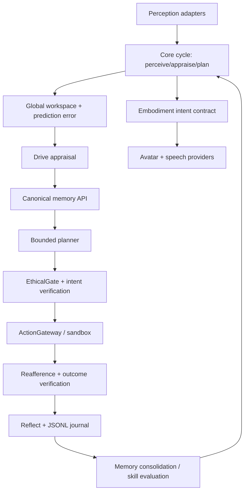

# Architecture and ownership

```text
                    ┌──────────────────────────────┐
                    │     Neuro-Kurisu 35.59.0       │
                    │ runtime/neuro-kurisu         │
                    │ canonical writable organism  │
                    └──────────────┬───────────────┘
                                   │ HTTP API
                         ┌─────────▼─────────┐
                         │ app / Grok shell  │
                         │ routing + UI + HUD│
                         └──────┬─────┬──────┘
                                │     │
                   postMessage │     │ research HTTP
                                │     │
            ┌───────────────────▼┐   ┌▼────────────────────┐
            │ Live2D / legacy    │   │ research bridge     │
            │ visual-only        │   │ read-only probes    │
            └────────────────────┘   └──────┬─────────────┘
                                             │
                           ┌─────────────────┼─────────────────┐
                           │                 │                 │
                    NeuroCore V143    NOMEGA Pass20     DeepCode v21
                    research-only     governed-research research-only

legacy/* and legacy/input-archives preserve source history/provenance only.
```

## Runtime data flow

`app/src/neuro-kurisu/api.ts` → `/api/organism/*` → `runtime/neuro-kurisu/src/server/server.mjs` → `OrganismRuntime` / `OrganismCore`.

`AvatarStage.tsx` receives canonical emotion/speaking state and sends only rendering commands to Live2D. On Live2D failure the UI explicitly offers the real legacy sprite path; no synthetic portrait is drawn.

`ResearchDock.tsx` → `/api/research/*` → `research/research_bridge.py` → isolated research candidates. No research endpoint mutates canonical runtime state.

`tools/super-gateway.mjs` provides one local entry surface and forwards `/api/organism/*` and `/api/research/*` to their owners.


## Shared runtime policies (WorkPass36)

- Numeric and cosine primitives are centralized in `runtime/neuro-kurisu/src/organism/core/NumericPrimitives.ts`; modules retain their distinct thresholds and metrics where those are semantically different.
- Common action costs live in `organism/core/ActionCostPolicy.ts`. Active inference, contextual world prediction, policy learning and the organism core consume the same policy.
- Adapter fingerprints use `organism/core/StableSerialization.ts`. JSON-mode and legacy fingerprint-mode are explicit; historical fingerprints are not silently rewritten.
- `developmental/MemoryOS2.ts` is the sole writable memory authority. Legacy memory relations are carried as migration provenance and projected for compatibility; unresolved old IDs are not inserted into canonical relationship indices.
- Archived source snapshots are SHA-256/content-addressed and immutable. Never point historical manifests at mutable active source files.


---

# NK1 v2.0 rebuild target contracts (2026-10-20)

The existing architecture above describes the current implementation lineage. The following is the target contract for the isolated rebuild and must not be read as a statement that all layers are already implemented.

## Runtime flow



## Twelve target layers and contracts

| Layer | Contract / owner | Required invariant |
|---|---|---|
| 1. Cognitive core | CognitiveCycleInput, CognitiveCycleResult, versioned OrganismEvent | One bounded cycle; no action bypasses policy |
| 2. Hierarchical memory | MemoryQuery, MemoryEvidence, MemoryRevision, MemorySnapshot | Single canonical store; provenance and revision identity survive restore |
| 3. Self-learning | SkillCandidate, EvaluationReport, PromotionDecision | Candidate cannot promote without holdout gain and no-regression gates |
| 4. Motivation | DriveSnapshot, InitiativeProposal | Drives are bounded signals; autonomy never bypasses ethics/approval |
| 5. Embodiment | EmbodimentIntent v1, speechEventId, audioClockId | Stale/cancelled events cannot overwrite newer embodiment state |
| 6. Metacognition | ConfidenceAssessment, KnowledgeGap | Confidence is evidence-linked and calibrated separately from raw model scores |
| 7. Social intelligence | UserModelObservation, ToMHypothesis | Hypotheses remain revisable and are not silently promoted to fact |
| 8. Temporal continuity | TemporalContext, SessionGap | Wall-clock and monotonic time are not conflated |
| 9. Ethics | IntentAssessment, EthicalDecision, AuditReceipt | Fail closed for unknown authorization; preserve refusal reason |
| 10. Neurosymbolic reasoning | GroundedFact, RuleEvaluation | Every conclusion traces to facts/rules; symbolic result cannot override policy |
| 11. Continual learning | LearningEpisode, RetentionReport | Isolated candidate state; rollback on retention/regression failure |
| 12. Observability | OrganismTraceEvent, HealthSnapshot | Bounded structured logs; secrets and raw sensitive text excluded |

## Cross-island event envelope

Every cross-island event is serializable and bounded, carrying schemaVersion, stable eventId, wall-clock occurredAt, correlationId, enumerated source/kind and a validated payload with provenance where relevant. Use monotonic clocks for deadlines and elapsed durations; wall-clock timestamps are for chronology only.

## Ownership and enforcement

Core owns cycle sequencing and cancellation. Memory owns persisted memories/revisions/retrieval. Motivation proposes goals; core schedules them. EthicalGate authorizes intents; ActionGateway is the only side-effect execution owner. Embodiment adapters render state and report provider status but do not invent cognitive state. Self/User models store revisable hypotheses with evidence. Observability records evidence but grants no capabilities. Validation tooling blocks promotion without mutating live cognitive state.

A contract is complete only when schema/type validation and behavior tests exercise it. Relevant tests include malformed input, stale sequence, cancellation, missing evidence, restart/restore and duplicate delivery. A type not imported by production code remains an isolated experiment, not an integrated feature.

Evidence labels are explicit: PROVEN, IMPLEMENTED, FUNCTIONAL INDICATOR, UNKNOWN/UNRESOLVED and FAILED. No test, architecture diagram, self-report or benchmark score proves subjective consciousness.
