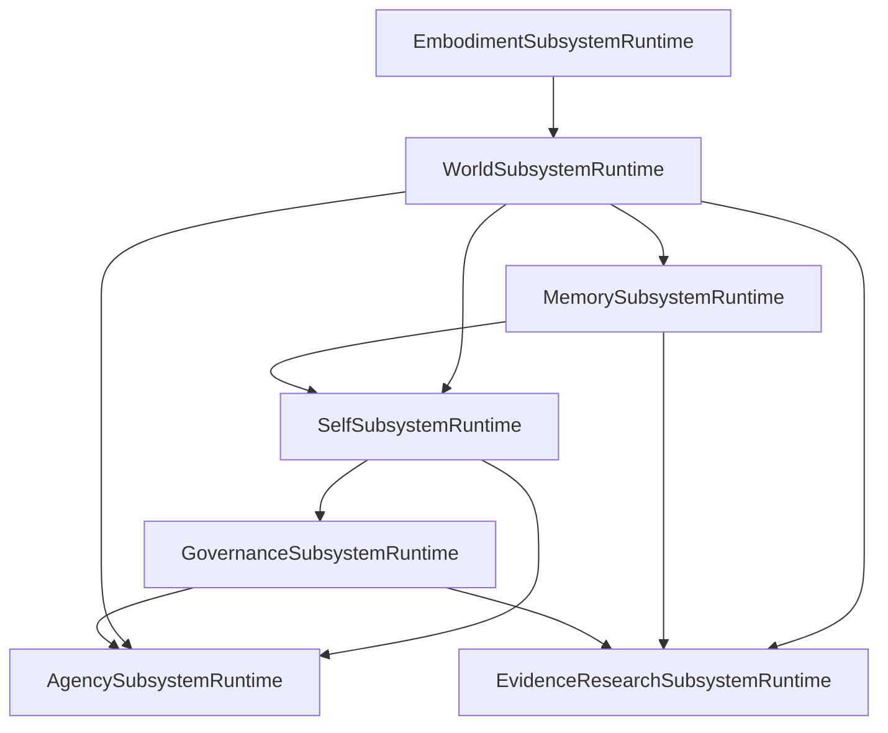

# NK1 Neural Connectome — Canonical Connection Matrix

**Date:** 2026-11-26  
**Source:** `workpass70-source@7e601680c765d6dc94e51e4c8f5e729b48a6f56e`  
**Source tree:** `bd5eb23dc2d7c029c6b9ae9e10c49257590e571e`  
**Work branch:** `aspect/neural-connectome-integration-20261126`  
**Scope:** first source-backed owner and contract map; not yet a complete file/method call graph.

## 1. Seven canonical owners

| Domain | Owner class | Source path | Declared dependencies | State responsibility |
|---|---|---|---|---|
| Embodiment | `EmbodimentSubsystemRuntime` | `runtime/neuro-kurisu/src/organism/core/EmbodimentSubsystemRuntime.ts` | none | Sensorium, multimodal/perception, camera evidence, interoception and active perception |
| World | `WorldSubsystemRuntime` | `runtime/neuro-kurisu/src/organism/core/WorldSubsystemRuntime.ts` | embodiment | Grounded world state, world models, prediction, active inference and world-causal bridges |
| Memory | `MemorySubsystemRuntime` | `runtime/neuro-kurisu/src/organism/core/MemorySubsystemRuntime.ts` | world | MemoryOS2, MemoryFabric, semantic/episodic/autobiographical/working memory, retention and consolidation |
| Self | `SelfSubsystemRuntime` | `runtime/neuro-kurisu/src/organism/core/SelfSubsystemRuntime.ts` | memory, world | Identity, SelfAuthorship, personhood, UserModel evidence, continuity and self-state |
| Governance | `GovernanceSubsystemRuntime` | `runtime/neuro-kurisu/src/organism/core/GovernanceSubsystemRuntime.ts` | self | Capabilities, integrity, replay, resilience, constitution and lifecycle controls |
| Agency | `AgencySubsystemRuntime` | `runtime/neuro-kurisu/src/organism/core/AgencySubsystemRuntime.ts` | self, world, governance | Motivation, goal lifecycle, budget, quorum, scheduling and project/action orchestration |
| Evidence / Research | `EvidenceResearchSubsystemRuntime` | `runtime/neuro-kurisu/src/organism/core/EvidenceResearchSubsystemRuntime.ts` | world, memory, governance | Prediction/evidence ledgers, firewall, research sessions, experiments and skill acquisition |

## 2. Owner dependency graph

The dependency graph is derived from `OrganismSystemContract.ts` and the runtime declarations. Edges below mean “depends on”, not “sends a runtime event”.

The contract declares execution ranks 0–6 in the same order: embodiment, world, memory, self, governance, agency, research. `OrganismSystemFabric` computes dependency order, cycles and a graph snapshot. The graph must still be executed by its owning test/audit on the current source SHA; source inspection alone is not a passing runtime audit.

## 3. Composition, lifecycle and causal contracts

| Layer | Canonical component | Source evidence | Intended role | Current classification |
|---|---|---|---|---|
| Host/runtime facade | `OrganismRuntime` | `core/OrganismRuntime.ts` | Public runtime boundary, input validation, host integrations, persistence and runtime orchestration | IMPLEMENTED; exact call-path audit pending |
| Cognitive/state boundary | `OrganismCore` | `core/OrganismCore.ts` | Canonical decision/state boundary and cognitive arbitration | IMPLEMENTED; call-site and ownership audit pending |
| Owner composition | `OrganismSystemFabric` | `core/OrganismSystemFabric.ts` | Own seven subsystem runtime references, contracts, graph, snapshots and restore | IMPLEMENTED; owner-level wiring present |
| Port facade | `CognitiveSubsystemPorts` / `CognitiveSubsystemRegistry` | `core/CognitiveSubsystemPorts.ts`, `core/CognitiveSubsystemRegistry.ts` | Dependency-inverted, read-only semantic ports over seven owners | IMPLEMENTED; additional probe hardening proposed in #1176 |
| Cognitive cycle | `UnifiedCognitiveCycle` | `system/UnifiedCognitiveCycle.ts` | Strict completion accounting; legacy six-stage vs full eleven-stage distinction | IMPLEMENTED; live full-cycle completion rate not remeasured here |
| Stage policy | `CycleCompletenessPolicy` | `system/CycleCompletenessPolicy.ts` | Require distinct stage IDs and CEF-verified causal lineage | IMPLEMENTED; test on current source pending |
| Stage receipts | `CognitiveStageReceipt` | `system/CognitiveStageReceipt.ts` | Validate owner-produced attention/memory stage receipts before projection | IMPLEMENTED; exact current-source integration test pending |
| Causal event fabric | `CognitiveEventFabric` | `system/CognitiveEventFabric.ts` | Causal event/receipt ledger, parent lineage and strict stage completeness; not canonical memory/world/goals store | IMPLEMENTED; durable rollover/recovery audit pending |
| Memory record owner | `MemoryOS2` | `developmental/MemoryOS2.ts` | Canonical memory records and temporal/evidence semantics | IMPLEMENTED; audit all write paths |
| Memory lifecycle boundary | `MemoryFabric` | `memory/MemoryFabric.ts` | Encode/link/revise/update/evidence/forget commands, receipts and projections | IMPLEMENTED; prove all writers route through it |
| Action boundary | `ActionGateway` | `system/ActionGateway.ts` | Tool contracts, approval, idempotency, execution and outcome classification | IMPLEMENTED; trace decision-to-action and recovery |
| World admission | Observation intake / grounded world owner | #821 draft and `WorldSubsystemRuntime` | Admit only fresh, consented and properly attested observations | Candidate implementation exists in PR #821; current-source parity not proven |
| UI / embodiment projection | Brain-affect bridge / renderer adapters | #1171 and #1164 drafts | Render canonical organism state without inventing missing affect or physical events | Existing adapter architecture; full real-device E2E not proven |

## 4. Eleven-stage causal spine

The source policy defines the full stage sequence:

1. `observation`
2. `prediction`
3. `appraisal`
4. `attention`
5. `memory`
6. `goal`
7. `plan`
8. `action`
9. `outcome`
10. `learning`
11. `self-update`

A six-stage legacy diagnostic remains for compatibility: observation → prediction → action → outcome → learning → self-update. It must never be promoted to full completion. Full completion requires all eleven distinct stage IDs, no duplicated IDs, a CEF full-lineage verdict, and full lineage integrity exactly 1.

## 5. Critical cross-domain connections to trace

| ID | Source → target | Required contract | Main failure to detect | Evidence needed |
|---|---|---|---|---|
| C01 | Authenticated ingress → Embodiment/World admission | Consent, source identity, freshness, schema, dedupe, payload safety | Forged physical provenance / stale samples | Negative tests + host-attested device receipt |
| C02 | Embodiment → World | Sensor/perception evidence with modality and provenance | Model inference promoted to physical observation | Exact admission and grounded-state tests |
| C03 | World → Appraisal | World revision, uncertainty, conflict, novelty, evidence confidence | World changes never affect appraisal or inflate confidence | Same-cycle runtime test + calibration |
| C04 | Appraisal → Attention | Relevance, uncertainty, prediction error, bounded budget | Attention uses stale or ungrounded signals | Same-tick evidence and ordering test |
| C05 | Attention → Memory retrieval | Typed query, owner receipt, retrieved IDs, confidence and status | Retrieval called without lineage or memory stage skipped silently | `CognitiveStageReceipt` test and memory query trace |
| C06 | Memory → Goal genesis | Relevant memories with provenance/freshness and user-vs-intrinsic origin | Recalled content manufactures user intent or internal goal | Origin-bound goal tests |
| C07 | Goal → Workspace/P61/P64 | One current-cycle workspace competition and decision ID | Workspace runs after arbitration or duplicates | PR #1186 exact-order test |
| C08 | Workspace → Decision arbitration | Same-cycle ignition plus bounded coalition contribution | Stale workspace signal / unbounded score bias | PR #1186 and coordinator instrumentation |
| C09 | Decision → Plan → Governance | Same decision ID, assumptions, risk, capability and approval | Decision identity lost or bypasses approval | Decision-lineage and negative authorization tests |
| C10 | Governance → ActionGateway | Capability scope, consent, approval ticket, idempotency key | Unauthorized or duplicate side effect | Gateway denial/replay tests |
| C11 | ActionGateway → External verifier | Exact execution receipt and independent postcondition | Tool success treated as verified world outcome | Provider read-back / independent verifier tests |
| C12 | Verified outcome → SelfAuthorship | Exact decision/outcome binding and intrinsic/external distinction | Planning credited as execution or unrelated outcome credited | SelfAuthorship replay/recovery tests |
| C13 | Outcome → Memory/learning | Evidence class, temporal credit, shadow evaluation and promotion gate | Training exposure counted as generalization | Paired seeds + sealed holdout + independent evaluator |
| C14 | Core/World/Action/CEF → Persistence | One checkpoint generation, atomic owner snapshots and migrations | Partial restore or CEF rollover losing receipts | Crash/power-loss/restart fault matrix |
| C15 | Canonical affect/body frame → Avatar/Voice/UI | Versioned brain frame, renderer-neutral semantics, playback receipt and audio clock | UI/avatar invents state or mouth motion without actual playback | Browser E2E + physical-device audio/video latency |
| C16 | Diagnostics → All owners | Read-only snapshot ports and bounded cached probes | Health check triggers a cognitive tick or scheduler side effect | Read-only probe negative tests |

## 6. Integration decisions

- Do not add a second seven-domain registry or second organism runtime.
- Treat `OrganismSystemFabric` as the current owner-composition root unless an exact-source audit disproves it.
- Treat `CognitiveSubsystemRegistry` as an observability/port layer, not the owner of subsystem state.
- Preserve one canonical `MemoryOS2` record owner and one `MemoryFabric` write/lifecycle boundary.
- Preserve `CognitiveEventFabric` as a causal ledger; do not turn it into an unbounded second memory store.
- Treat checkpoint, continuity journal and watchdog as one durability design with explicit ownership, not three competing persistence systems.
- Do not merge any diverged draft PR just because a subset of its workflow runs succeeded. Selectively port only after current-source diff, base/head ancestry, exact-head CI and ownership review.

## 7. Open gaps / not yet proven

- Full source file/method inventory at exact current tree SHA.
- Actual call graph from `OrganismRuntime` into `OrganismCore` and the seven owners.
- Per-stage call sites and live causal edges for all eleven stages.
- Complete MemoryOS2 writer audit, including compatibility and derived projections.
- Exact checkpoint ownership across Core, World, ActionGateway, CEF and sidecars.
- Full current-source import/dependency/physical-ownership audit.
- Browser/mobile UI, avatar and voice end-to-end acceptance on current source.
- Android/Termux hardware soak, target-device latency and recovery.
- Independent memory/learning holdout and source/ZIP/license parity.

**Status:** structural map established; method-level connectome and runtime verification remain in progress.
