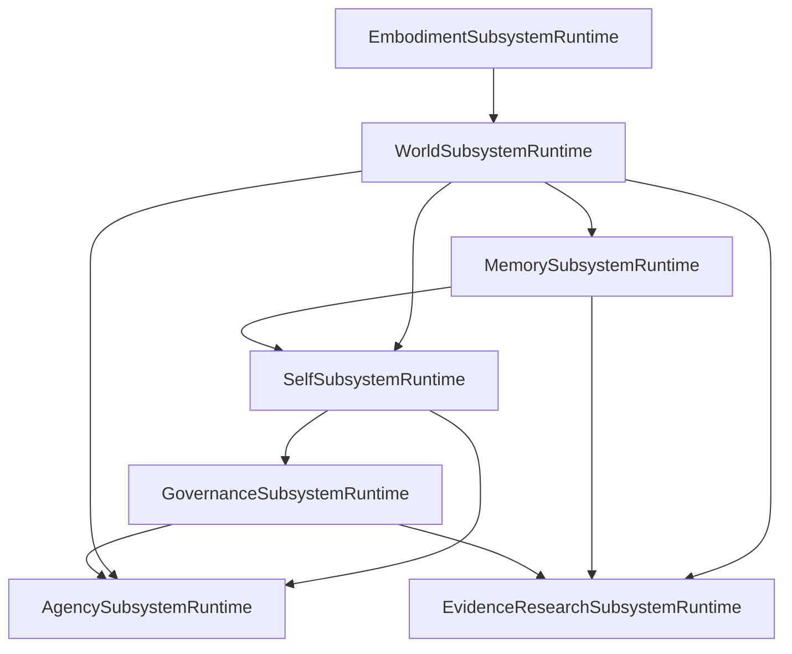

# NK1 Neural Connectome — Canonical Connection Matrix

**Date:** 2026-11-26  
**Source:** `workpass70-source@7e601680c765d6dc94e51e4c8f5e729b48a6f56e`  
**Source tree:** `bd5eb23dc2d7c029c6b9ae9e10c49257590e571e`  
**Work branch:** `aspect/neural-connectome-integration-20261126`  
**Scope:** first source-backed owner and contract map; not yet a complete file/method call graph.

## 1. Seven canonical owners

| Domain | Owner class | Source path | Declared dependencies | State responsibility |
|---|---|---|---|---|
| Embodiment | `EmbodimentSubsystemRuntime` | `runtime/neuro-kurisu/src/organism/core/EmbodimentSubsystemRuntime.ts` | none | Sensorium, multimodal/perception, camera evidence, interoception and active perception |
| World | `WorldSubsystemRuntime` | `runtime/neuro-kurisu/src/organism/core/WorldSubsystemRuntime.ts` | embodiment | Grounded world state, world models, prediction, active inference and world-causal bridges |
| Memory | `MemorySubsystemRuntime` | `runtime/neuro-kurisu/src/organism/core/MemorySubsystemRuntime.ts` | world | MemoryOS2, MemoryFabric, semantic/episodic/autobiographical/working memory, retention and consolidation |
| Self | `SelfSubsystemRuntime` | `runtime/neuro-kurisu/src/organism/core/SelfSubsystemRuntime.ts` | memory, world | Identity, SelfAuthorship, personhood, UserModel evidence, continuity and self-state |
| Governance | `GovernanceSubsystemRuntime` | `runtime/neuro-kurisu/src/organism/core/GovernanceSubsystemRuntime.ts` | self | Capabilities, integrity, replay, resilience, constitution and lifecycle controls |
| Agency | `AgencySubsystemRuntime` | `runtime/neuro-kurisu/src/organism/core/AgencySubsystemRuntime.ts` | self, world, governance | Motivation, goal lifecycle, budget, quorum, scheduling and project/action orchestration |
| Evidence / Research | `EvidenceResearchSubsystemRuntime` | `runtime/neuro-kurisu/src/organism/core/EvidenceResearchSubsystemRuntime.ts` | world, memory, governance | Prediction/evidence ledgers, firewall, research sessions, experiments and skill acquisition |

## 2. Owner dependency graph

The dependency graph is derived from `OrganismSystemContract.ts` and the runtime declarations. Edges below mean “depends on”, not “sends a runtime event”.

The contract declares execution ranks 0–6 in the same order: embodiment, world, memory, self, governance, agency, research. `OrganismSystemFabric` computes dependency order, cycles and a graph snapshot. The graph must still be executed by its owning test/audit on the current source SHA; source inspection alone is not a passing runtime audit.

## 3. Composition, lifecycle and causal contracts

| Layer | Canonical component | Source evidence | Intended role | Current classification |
|---|---|---|---|---|
| Host/runtime facade | `OrganismRuntime` | `core/OrganismRuntime.ts` | Public runtime boundary, input validation, host integrations, persistence and runtime orchestration | IMPLEMENTED; exact call-path audit pending |
| Cognitive/state boundary | `OrganismCore` | `core/OrganismCore.ts` | Canonical decision/state boundary and cognitive arbitration | IMPLEMENTED; call-site and ownership audit pending |
| Owner composition | `OrganismSystemFabric` | `core/OrganismSystemFabric.ts` | Own seven subsystem runtime references, contracts, graph, snapshots and restore | IMPLEMENTED; owner-level wiring present |
| Port facade | `CognitiveSubsystemPorts` / `CognitiveSubsystemRegistry` | `core/CognitiveSubsystemPorts.ts`, `core/CognitiveSubsystemRegistry.ts` | Dependency-inverted, read-only semantic ports over seven owners | IMPLEMENTED; additional probe hardening proposed in #1176 |
| Cognitive cycle | `UnifiedCognitiveCycle` | `system/UnifiedCognitiveCycle.ts` | Strict completion accounting; legacy six-stage vs full eleven-stage distinction | IMPLEMENTED; live full-cycle completion rate not remeasured here |
| Stage policy | `CycleCompletenessPolicy` | `system/CycleCompletenessPolicy.ts` | Require distinct stage IDs and CEF-verified causal lineage | IMPLEMENTED; test on current source pending |
| Stage receipts | `CognitiveStageReceipt` | `system/CognitiveStageReceipt.ts` | Validate owner-produced attention/memory stage receipts before projection | IMPLEMENTED; exact current-source integration test pending |
| Causal event fabric | `CognitiveEventFabric` | `system/CognitiveEventFabric.ts` | Causal event/receipt ledger, parent lineage and strict stage completeness; not canonical memory/world/goals store | IMPLEMENTED; durable rollover/recovery audit pending |
| Memory record owner | `MemoryOS2` | `developmental/MemoryOS2.ts` | Canonical memory records and temporal/evidence semantics | IMPLEMENTED; audit all write paths |
| Memory lifecycle boundary | `MemoryFabric` | `memory/MemoryFabric.ts` | Encode/link/revise/update/evidence/forget commands, receipts and projections | IMPLEMENTED; prove all writers route through it |
| Action boundary | `ActionGateway` | `system/ActionGateway.ts` | Tool contracts, approval, idempotency, execution and outcome classification | IMPLEMENTED; trace decision-to-action and recovery |
| World admission | Observation intake / grounded world owner | #821 draft and `WorldSubsystemRuntime` | Admit only fresh, consented and properly attested observations | Candidate implementation exists in PR #821; current-source parity not proven |
| UI / embodiment projection | Brain-affect bridge / renderer adapters | #1171 and #1164 drafts | Render canonical organism state without inventing missing affect or physical events | Existing adapter architecture; full real-device E2E not proven |

## 4. Eleven-stage causal spine

The source policy defines the full stage sequence:

1. `observation`
2. `prediction`
3. `appraisal`
4. `attention`
5. `memory`
6. `goal`
7. `plan`
8. `action`
9. `outcome`
10. `learning`
11. `self-update`

A six-stage legacy diagnostic remains for compatibility: observation → prediction → action → outcome → learning → self-update. It must never be promoted to full completion. Full completion requires all eleven distinct stage IDs, no duplicated IDs, a CEF full-lineage verdict, and full lineage integrity exactly 1.

## 5. Critical cross-domain connections to trace

| ID | Source → target | Required contract | Main failure to detect | Evidence needed |
|---|---|---|---|---|
| C01 | Authenticated ingress → Embodiment/World admission | Consent, source identity, freshness, schema, dedupe, payload safety | Forged physical provenance / stale samples | Negative tests + host-attested device receipt |
| C02 | Embodiment → World | Sensor/perception evidence with modality and provenance | Model inference promoted to physical observation | Exact admission and grounded-state tests |
| C03 | World → Appraisal | World revision, uncertainty, conflict, novelty, evidence confidence | World changes never affect appraisal or inflate confidence | Same-cycle runtime test + calibration |
| C04 | Appraisal → Attention | Relevance, uncertainty, prediction error, bounded budget | Attention uses stale or ungrounded signals | Same-tick evidence and ordering test |
| C05 | Attention → Memory retrieval | Typed query, owner receipt, retrieved IDs, confidence and status | Retrieval called without lineage or memory stage skipped silently | `CognitiveStageReceipt` test and memory query trace |
| C06 | Memory → Goal genesis | Relevant memories with provenance/freshness and user-vs-intrinsic origin | Recalled content manufactures user intent or internal goal | Origin-bound goal tests |
| C07 | Goal → Workspace/P61/P64 | One current-cycle workspace competition and decision ID | Workspace runs after arbitration or duplicates | PR #1186 exact-order test |
| C08 | Workspace → Decision arbitration | Same-cycle ignition plus bounded coalition contribution | Stale workspace signal / unbounded score bias | PR #1186 and coordinator instrumentation |
| C09 | Decision → Plan → Governance | Same decision ID, assumptions, risk, capability and approval | Decision identity lost or bypasses approval | Decision-lineage and negative authorization tests |
| C10 | Governance → ActionGateway | Capability scope, consent, approval ticket, idempotency key | Unauthorized or duplicate side effect | Gateway denial/replay tests |
| C11 | ActionGateway → External verifier | Exact execution receipt and independent postcondition | Tool success treated as verified world outcome | Provider read-back / independent verifier tests |
| C12 | Verified outcome → SelfAuthorship | Exact decision/outcome binding and intrinsic/external distinction | Planning credited as execution or unrelated outcome credited | SelfAuthorship replay/recovery tests |
| C13 | Outcome → Memory/learning | Evidence class, temporal credit, shadow evaluation and promotion gate | Training exposure counted as generalization | Paired seeds + sealed holdout + independent evaluator |
| C14 | Core/World/Action/CEF → Persistence | One checkpoint generation, atomic owner snapshots and migrations | Partial restore or CEF rollover losing receipts | Crash/power-loss/restart fault matrix |
| C15 | Canonical affect/body frame → Avatar/Voice/UI | Versioned brain frame, renderer-neutral semantics, playback receipt and audio clock | UI/avatar invents state or mouth motion without actual playback | Browser E2E + physical-device audio/video latency |
| C16 | Diagnostics → All owners | Read-only snapshot ports and bounded cached probes | Health check triggers a cognitive tick or scheduler side effect | Read-only probe negative tests |

## 6. Integration decisions

- Do not add a second seven-domain registry or second organism runtime.
- Treat `OrganismSystemFabric` as the current owner-composition root unless an exact-source audit disproves it.
- Treat `CognitiveSubsystemRegistry` as an observability/port layer, not the owner of subsystem state.
- Preserve one canonical `MemoryOS2` record owner and one `MemoryFabric` write/lifecycle boundary.
- Preserve `CognitiveEventFabric` as a causal ledger; do not turn it into an unbounded second memory store.
- Treat checkpoint, continuity journal and watchdog as one durability design with explicit ownership, not three competing persistence systems.
- Do not merge any diverged draft PR just because a subset of its workflow runs succeeded. Selectively port only after current-source diff, base/head ancestry, exact-head CI and ownership review.

## 7. Open gaps / not yet proven

- Full source file/method inventory at exact current tree SHA.
- Actual call graph from `OrganismRuntime` into `OrganismCore` and the seven owners.
- Per-stage call sites and live causal edges for all eleven stages.
- Complete MemoryOS2 writer audit, including compatibility and derived projections.
- Exact checkpoint ownership across Core, World, ActionGateway, CEF and sidecars.
- Full current-source import/dependency/physical-ownership audit.
- Browser/mobile UI, avatar and voice end-to-end acceptance on current source.
- Android/Termux hardware soak, target-device latency and recovery.
- Independent memory/learning holdout and source/ZIP/license parity.

**Status:** structural map established; method-level connectome and runtime verification remain in progress.

## 8. Runtime call path confirmed by source inspection

The first concrete end-to-end path is visible in `core/OrganismRuntime.ts`:

1. **Construction:** `OrganismRuntime` constructs one `OrganismCore` from the configured `stateStore` and operational cycle mode. The runtime also owns one `CognitiveEventFabric` instance and one `UnifiedCognitiveCycle` instance.
2. **Restore:** `OrganismRuntime.init()` calls `core.init()`, reads `core.systemSnapshot()`, restores runtime-owned `CognitiveEventFabric` and `UnifiedCognitiveCycle` state from the canonical system snapshot, and restores the other sidecars.
3. **Input/perception:** the runtime converts multimodal interpretation inputs through `core.recordMultimodalObservation()` and `core.fuseMultimodalObservations()`. It explicitly avoids running a second runtime-local PerceptionEngine against the same raw sample.
4. **Cognitive execution:** one `core.observe(...)` call executes the current observation. The runtime measures the Core perception snapshot around that call rather than re-processing the same sample.
5. **Action and world outcome:** the runtime continues through planning/embodied execution and classifies the resulting world outcome as external or simulated; only externally grounded, verified and independent outcomes receive the corresponding evidence flags.
6. **Causal trace:** `CognitiveEventFabric.recordOperationalCycle()` receives observation, prediction, appraisal, attention, memory, goal, plan, action, outcome, learning and self-update stage data. Attention and memory owner receipts are attached when available.
7. **Lineage verification:** `verifyOperationalCycle()` checks the eleven stage IDs and owner receipts. `UnifiedCognitiveCycle.evaluate()` consumes the CEF lineage result; full completion requires both full lineage and owner evidence.
8. **Persistence projection:** runtime snapshots are written back through `core.setRuntimeCognitiveEventFabric()` and `core.setRuntimeUnifiedCognitiveCycle()`; the metacognitive episode is sent through `core.recordMetacognitiveEpisode()`, which reports whether its canonical memory persistence succeeded.
9. **Independent export:** `independentEvaluationEvidenceSnapshot()` exports a privacy-minimized bundle from the runtime-owned CEF, reality evidence and cycle counters.

Useful source anchors (line numbers from the fetched current source response):
- `OrganismRuntime` constructor / Core creation: approximately lines 430–560.
- Runtime restore and CEF/UnifiedCycle restore: lines 619–702.
- Single `core.observe()` and multimodal admission: lines 1210–1240.
- Operational cycle trace and lineage verification: lines 1796–1865.
- CEF and UnifiedCycle snapshot projection / metacognitive persistence: lines 1939–2016.
- Independent evaluation evidence export: lines 2056–2065.

### What this proves — and what it does not

- **Source-present / connected path:** a single runtime owns the CEF and UnifiedCycle, invokes Core once for the cognitive observation, records the full eleven-stage trace, verifies lineage and projects runtime state back through Core persistence APIs.
- **Not yet proven:** all eleven stages execute successfully on a real operational tick; every attention/memory receipt is always present and correctly bound; the complete checkpoint generation atomically includes every relevant sidecar; crash/power-loss recovery preserves all receipts; device/browser behavior and latency meet target thresholds.
- **Do not create a second CEF or UnifiedCognitiveCycle inside Core.** The current source path treats these as runtime-owned components whose snapshots are persisted through Core's system snapshot boundary.
- **Do not call simulated world outcomes externally verified.** The runtime's own metacognitive episode marks simulated outcomes as simulated and records their limitation.

This moves the connection map beyond a component inventory: one causal runtime spine is source-visible. Its exact-source regression and failure-injection verification remains the next gate.

## 9. Verified read-only diagnostic edge and memory owner trace — 26 Nov 2026

### C16 — diagnostics must not mutate scheduler state

- The first test-only run exposed an actual side effect: `agency.multiProjectSchedule()` delegated to the active scheduler's `choose()` command, which mutates `lastDecision`.
- The isolated fix introduces `multiProjectScheduleSnapshot()`, backed by `projectScheduler.snapshot()`, and maps the diagnostics port to that read-only accessor. The active `multiProjectSchedule()` remains a separate command.
- A dedicated regression now exercises all 34 ports, exception redaction, malformed snapshot classification, per-owner failure aggregation, cache refresh and real-Core assertions that the tick and scheduler snapshot do not change.
- Exact-head workflow [45798424365](https://github.com/ailtron1ss-rgb/NK1/actions/runs/45798424365) passed all focused steps, plus [Module Dependency Audit](https://github.com/ailtron1ss-rgb/NK1/actions/runs/45798424335), [Unified organism runtime](https://github.com/ailtron1ss-rgb/NK1/actions/runs/45798424134), [NeuroCore regression](https://github.com/ailtron1ss-rgb/NK1/actions/runs/45798424286) and [Integrated Software Baseline](https://github.com/ailtron1ss-rgb/NK1/actions/runs/45798424476) on that PR head.
- The branch is exactly 8 commits ahead and 0 behind its stated canonical base at the time checked; the PR changes seven files, remains Draft and is not merged.

### MemoryOS2 / MemoryFabric single-owner inspection

The current source constructs one MemoryOS2 within MemorySubsystemRuntime and passes the same object to MemoryFabric. N.E.K.O./Hexis import bridges and the canonical lifecycle authority are wired to MemoryFabric. The lifecycle authority delegates maintenance to MemoryFabric, and the sampled Core direct MemoryOS2 accessors are reads/snapshots/diagnostics while mutation paths examined route through MemoryFabric.

The remaining public legacy adapter helpers in MemorySubstrateCoordinator deserve a complete repository-wide call-site search and writer-boundary test. The source comments say production restore/ingest route through MemoryFabric; this source inspection alone does not conclusively prove there are no other bypass writers anywhere in the full repository. Accordingly C05/C13 memory writer boundary remains **partially verified**, not closed.

### Evidence boundary

All successful CI above ran against the isolated PR merge ref. It proves the checked tests/build contracts on that ref, not canonical integration, semantic `tsc`, Android/Termux soak, measured runtime latency, or release readiness.

## 10. Later exact-head integrations — 26 Nov 2026

### C16 hardening: diagnostics and exception metadata

PR [#1197](https://github.com/ailtron1ss-rgb/NK1/pull/1197), branch `aspect/cognitive-port-readonly-observability-20261126`:
- The diagnostics port now uses `multiProjectScheduleSnapshot()`, not the active mutating scheduler.
- Every one of 34 snapshot ports is probed with bounded, cached, payload-free metadata across seven domains.
- Exception messages and caller-controlled exception class names are not exposed.
- Exact-head run [45803686848](https://github.com/ailtron1ss-rgb/NK1/actions/runs/45803686848) passed 29 steps spanning diagnostics, memory owner/lifecycle/restore, 11-stage CEF, owner receipts and restore integrity.
- All 32 Actions workflow runs associated with head `1bcb011...` ended success. The startup smoke initially had a development-supervisor timeout just after Vite was ready; rerun attempt 2 passed.
- This PR remains Draft and not merged.

### World context restore

PR [#1199](https://github.com/ailtron1ss-rgb/NK1/pull/1199):
- `lastWorldContext` is rehydrated from the persisted canonical `UnifiedLatentWorldState.currentObservation()`, guarded by `isWorldContext()`.
- P27's owner is restored before the derived cached latent is read.
- RED [45803058277](https://github.com/ailtron1ss-rgb/NK1/actions/runs/45803058277), GREEN [45803373594](https://github.com/ailtron1ss-rgb/NK1/actions/runs/45803373594).
- All 13 workflows on PR head `06a2014...` passed, including Unified Organism Runtime 39/39, NeuroCore 55/55, World Perception, Memory Integrity, prototype startup and integrated baseline.
- This PR remains Draft and not merged.

### Memory lifecycle replay result identity

PR [#1201](https://github.com/ailtron1ss-rgb/NK1/pull/1201):
- Replay of a persisted encode receipt now resolves the exact original memory item via `MemoryOS2.snapshotItem()`, instead of following the chain to a later revision tip.
- RED [45803492755](https://github.com/ailtron1ss-rgb/NK1/actions/runs/45803492755), GREEN [45803609717](https://github.com/ailtron1ss-rgb/NK1/actions/runs/45803609717). The focused workflow also ran existing WorkPass31 lifecycle receipt coverage.
- All 17 workflows on PR head `98fef39...` passed, including Memory Integrity 18/18, Unified Organism Runtime 39/39, Module Dependency and integrated software baseline.
- This PR remains Draft and not merged.

### Exact source inventory

For canonical source SHA `7e601680...`, the recursive tree returned 11,596 entries / 10,676 files / 3,857 source files, including 747 organism runtime source files. This is a file inventory only and must not be treated as feature completeness.

### Current gaps

- MemorySubstrateCoordinator contains legacy direct-write adapter helpers; sampled production call sites were read-only/projection paths, and the canonical production writers route through MemoryFabric. A whole-repo writer call-site census is still open.
- Exact semantic TypeScript `tsc` is not available in the focused workflow; only Node strip-syntax validation passed.
- No physical Android/Termux restore or power-loss soak; no microphone/TTS playback, lip sync, UI/browser end-to-end acceptance or phone performance measurement.
- No RU/EN sealed holdout, >=5 paired seeds, scale benchmark at the required 10k/100k tiers, archive/license/SBOM parity check or new Release.
- All implementation is isolated on Draft PR branches. The canonical branch and immutable archive have not changed.

## 11. Final exact-head and release/source status — 26 Nov 2026

| PR | Aspect | Head | Ahead / behind | Exact-head workflow result | Merge state |
|---|---|---|---:|---|---|
| [#1197](https://github.com/ailtron1ss-rgb/NK1/pull/1197) | Read-only diagnostics, memory and 11-stage CEF regressions | `1bcb011...` | 14 / 0 | 32/32 workflow runs success; focused suite 29/29 steps | Draft / unmerged |
| [#1199](https://github.com/ailtron1ss-rgb/NK1/pull/1199) | World context / P27 latent restore continuity | `06a2014...` | 3 / 0 | 13/13 workflow runs success | Draft / unmerged |
| [#1201](https://github.com/ailtron1ss-rgb/NK1/pull/1201) | Memory lifecycle replay result identity | `98fef39...` | 3 / 0 | 17/17 workflow runs success | Draft / unmerged |
| [#1202](https://github.com/ailtron1ss-rgb/NK1/pull/1202) | Truthful runtime shutdown durability | `9678599...` | 4 / 0 | 30/30 workflow runs success; focused 4/4, Unified Runtime 39/39 | Draft / unmerged |

All three PRs use the same base `workpass70-source@7e601680...`; none is behind that base. Successful workflows are exact isolated PR-head evidence, not canonical integration.

The current GitHub Release listing still contains only 19-Oct-2026 assets (`Neuro_Kurisu_WORKPASS70_2026-10-19.zip` and `Neuro_Kurisu_WORKPASS70_HOTFIX1_2026-10-19.zip`). These aspect fixes are not included in either asset.

The full Master Plan X is estimated at **36/100 ±8 pp** for engineering integration / verification as a whole. Device testing, independent sealed evaluation, full checkpoint crash/power-loss evidence, global writer census, semantic `tsc`, source/archive parity, license/SBOM and Release gates remain incomplete.

### Runtime shutdown durability (PR #1202)

| Interface / owner | Shutdown behavior | Failure semantics | Verification |
|---|---|---|---|
| Organism Core | Final `core.flush()` precedes sidecar and World completion receipt | Fail-fast; no completion receipt on failure | Focused test 4/4; exact-head NeuroCore regression |
| World environment | Forced final `checkpointWorld(true)` | Fail-fast; no completion receipt on failure | Focused injected World-write failure test; unified runtime suite |
| Cognitive spine sidecar | Save helper returns `durable` or `failed` | Best-effort save, but any failure makes overall shutdown `partial` | Focused injected sidecar-write failure test |
| Risk-aware recovery sidecar | Save helper returns `durable` or `failed` | Best-effort save, but any failure makes overall shutdown `partial` | Success-path test + unified runtime suite |
| Shutdown journal receipt | `runtime.stop.durable` only when all four stores report durable; otherwise `runtime.stop.partial` / warn with per-owner status | Receipt write remains diagnostic best effort | Focused success/partial assertions |

- RED [45806050935](https://github.com/ailtron1ss-rgb/NK1/actions/runs/45806050935); GREEN [45806383022](https://github.com/ailtron1ss-rgb/NK1/actions/runs/45806383022), 4/4.
- Exact-head `9678599bf6812a3a41042fac208d17b0f0560bcd`: **30/30 Actions workflows success**; Unified Organism Runtime [45806382842](https://github.com/ailtron1ss-rgb/NK1/actions/runs/45806382842) 39/39 steps, NeuroCore regression [45806382657](https://github.com/ailtron1ss-rgb/NK1/actions/runs/45806382657) 55/55, integrated software baseline [45806382669](https://github.com/ailtron1ss-rgb/NK1/actions/runs/45806382669), startup smoke [45806383035](https://github.com/ailtron1ss-rgb/NK1/actions/runs/45806383035) and Module Dependency Audit [45806384600](https://github.com/ailtron1ss-rgb/NK1/actions/runs/45806384600) all passed.
- PR [#1202](https://github.com/ailtron1ss-rgb/NK1/pull/1202) remains Draft / unmerged. This is not a cross-store atomic checkpoint protocol; power-loss/device recovery remains unproven.
